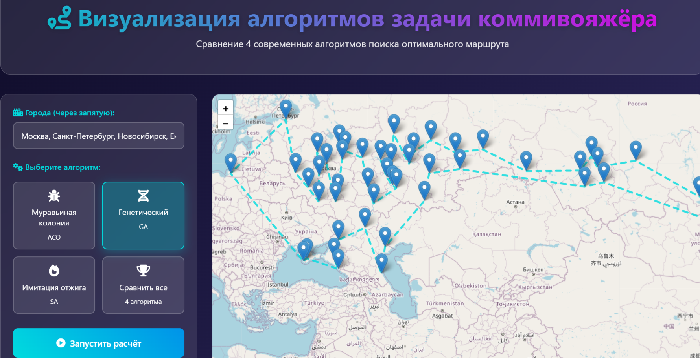
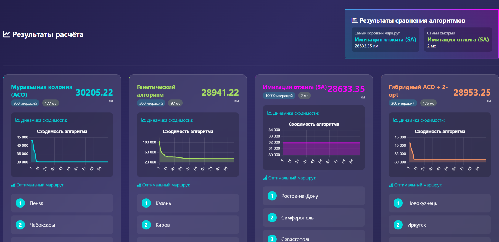
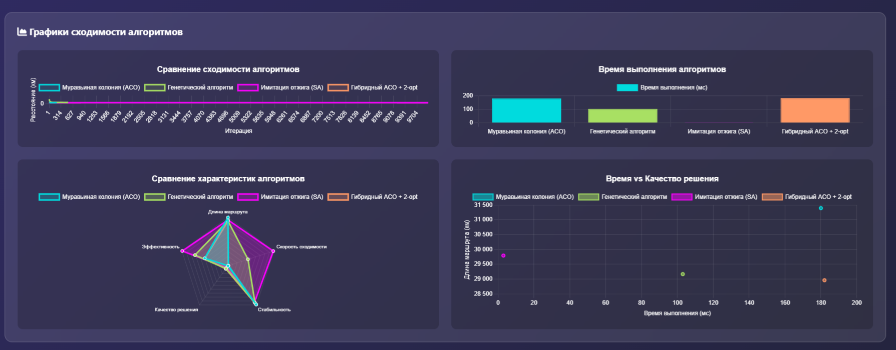

# Визуализация алгоритмов задачи коммивояжёра

TSP solvers in Java: ant colony optimization, a genetic algorithm, simulated annealing, and a hybrid ACO + 2-opt method, with a web UI for map and convergence charts.

Курсовая работа по дисциплине «Алгоритмы и анализ сложности» (декабрь 2025). Автор: София Родионова, Миасский филиал ЧелГУ.

## Цель

Изучить метаэвристические подходы к задаче коммивояжёра, реализовать их на Java и сравнить по качеству маршрута, времени работы и устойчивости на тестовых наборах разной размерности.

## Что реализовано

Четыре решателя с общим контрактом: метод `solve(RoutingMatrix)` возвращает объект `AlgorithmResult` (маршрут, длина, время, история сходимости, число итераций). В отчёте указано, что алгоритмы реализуют интерфейс `SolverStrategy`.

| Класс | Метод | Параметры из кода |
| --- | --- | --- |
| `ACOSolver` | Муравьиная колония, стратегия Elitist Ant System (феромон откладывается на лучшем маршруте итерации) | 30 муравьёв, 200 итераций, α = 1.0, β = 2.0, ρ = 0.5, Q = 100 |
| `GeneticAlgorithmSolver` | Перестановочное кодирование, тасование Фишера–Йетса, турнирная селекция, Ordered Crossover, Swap Mutation, элитизм | популяция 100, 500 поколений, вероятность мутации 0.02, доля элиты 0.1, размер турнира 5 |
| `SimulatedAnnealingSolver` | Обмен двух городов как соседнее состояние, геометрическое охлаждение | 10 000 итераций, T₀ = 10 000, коэффициент охлаждения 0.995 |
| `HybridACO2OptSolver` | Сначала ACO для глобального поиска, затем локальное улучшение 2-opt | настройки ACO без изменений |

В приложениях к работе после GA и SA также вызывается `LocalSearch.twoOpt` — это видно в исходниках, хотя в тексте главы акцент на 2-opt сделан у гибридного метода.

Веб-часть (в полном комплексе, код интерфейса в приложениях к работе не приведён):

- бэкенд на Spring Boot, REST, обмен JSON;
- клиент на HTML5, CSS3 и нативном JavaScript;
- карта маршрута: Leaflet + OpenStreetMap (полилинии и нумерованные маркеры);
- графики сходимости и сравнения: Chart.js;
- геокодирование по встроенному справочнику координат (хеш-карта) и генерация случайных точек в bounding box России.

## Стек

Java, Spring Boot, REST / JSON, HTML5, CSS3, JavaScript, Leaflet, Chart.js.

## Результаты

Цифры ниже взяты из текста курсовой (раздел сравнительного анализа). Это результаты на тестовых группах, а не единственный прогон.

- **Малые задачи (5–8 городов).** Все четыре алгоритма находили глобальный оптимум, практически мгновенно (в работе — «100% эффективность»).
- **Средние задачи (10–15 городов).** Муравьиный алгоритм стабильно давал качественные маршруты, время работы выросло до **200–500 мс**. Генетический алгоритм был быстрее, но качество решений было нестабильным. Имитация отжига показала наибольший разброс без тонкой настройки. Гибрид оказался лучшим по качеству и выигрывал у чистого ACO в среднем **на 3–5%**.
- **Большие задачи (20–30 городов).** Время ACO линейно выросло до **1–2 с**. Качество GA на таких объёмах снижалось. SA работала быстрее всех, но часто давала решения далеко от оптимума. Гибрид подтвердил лидерство: маршруты «без явных дефектов» за **2–3 с**.
- По графикам сходимости в работе: ACO спускается плавно, GA — рывками, SA в начале имеет хаотичный график.

На скриншоте интерфейса зафиксирован один конкретный прогон (много городов на карте России): SA — 28 633,35 км за 2 мс (10 000 итераций), GA — 28 941,22 км за 97 мс, гибрид — 28 953,25 км за 176 мс, ACO — 30 205,22 км за 177 мс. Это иллюстрация UI, а не усреднённая таблица экспериментов.

## Скриншоты

Главная панель: ввод городов, выбор алгоритма, карта маршрута.

Карточки результатов и спарклайны сходимости.

Сводные графики: сходимость, время, характеристики, «время vs качество».

## Состав репозитория и чего не хватает

В приложениях B–E курсовой приведены только четыре класса-решателя (`ru.mf.tsp.service`). Приложение А — скриншоты интерфейса.

В тексте работы используются, но **в приложениях нет исходников** следующих частей, без которых проект не собирается и не запускается:

- `ru.mf.tsp.model.RoutingMatrix` (в коде есть поле `size` и метод `getDistance`);
- `ru.mf.tsp.dto.AlgorithmResult` (поля, которыми пользуются решатели: `tour`, `convergenceHistory`, `iterations`);
- `LocalSearch` с методами `twoOpt` и `calculateDistance`;
- интерфейс `SolverStrategy`;
- подсистема геокодирования, REST-контроллеры, Spring Boot-приложение (`pom.xml` / `application.properties`);
- клиентский код (HTML/CSS/JS, Leaflet, Chart.js).

Код решателей сохранён как в приложениях, без дописывания недостающих классов.

## Как запустить

Полное веб-приложение из этого репозитория запустить нельзя: нет обвязки Spring Boot и фронтенда. Когда недостающие классы и клиент будут добавлены, типичный путь такой:

1. JDK 17+ и Maven.
2. Собрать и запустить Spring Boot-приложение (в работе клиент ходит к REST API асинхронными HTTP-запросами).
3. Открыть веб-интерфейс, ввести города через запятую или сгенерировать тестовый набор, выбрать алгоритм и запустить расчёт.

Сами решатели вызываются так: передать заполненную `RoutingMatrix` в `solve(...)` соответствующего класса.

## Лицензия

MIT, Sofia Rodionova, 2026.
